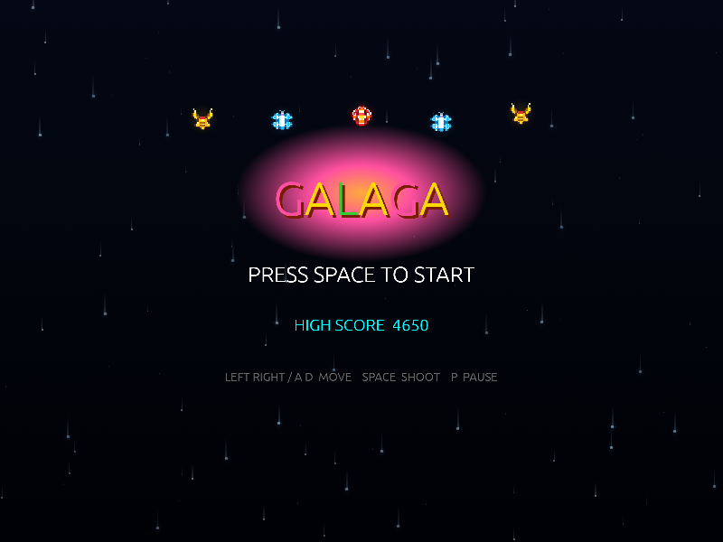
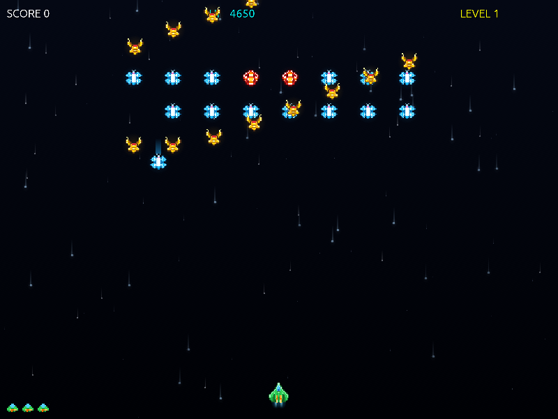

# Galaga — Rust + eframe

Clone arcade con sprite pixel-art disegnati in codice e audio sintetizzato.
Un unico motore Rust alimenta l'app desktop e il canvas WebAssembly.

| Menu | Gameplay |
|------|----------|
|  |  |

## Avvio desktop

Richiede Rust **1.95 o successivo** con Cargo. Supporto previsto: Windows x64,
Linux x64, macOS Intel e Apple Silicon. Non servono .NET, Avalonia o OpenAL.

```sh
cargo run --release --locked
```

Su Debian/Ubuntu, installare prima le librerie di sviluppo:

```sh
sudo apt-get install build-essential pkg-config libasound2-dev libxkbcommon-dev \
  libx11-dev libxi-dev libxrandr-dev libxcursor-dev libgl1-mesa-dev libegl1-mesa-dev
```

Su Windows serve il toolchain Rust MSVC con Visual Studio Build Tools; su macOS
gli Xcode Command Line Tools. L'app usa OpenGL; se il dispositivo audio non e'
disponibile continua senza suono.

## Browser / WebAssembly

Installare il target wasm e [Trunk](https://trunkrs.dev/), quindi:

```sh
rustup target add wasm32-unknown-unknown
cargo install trunk --version 0.21.14 --locked
trunk serve --open
```

Per distribuire:

```sh
trunk build --release --locked
python3 -m http.server 8080 --directory dist
```

Pubblicare il contenuto di `dist/` su un server statico HTTP(S). Gli URL sono
relativi, quindi il gioco puo' essere ospitato anche in una sottocartella.
Non aprire `index.html` con `file://`. Nessun hosting viene configurato
automaticamente. Richiesti browser desktop moderni con WebGL2 e tastiera.

Fare clic sul canvas o su **Enable audio** per attivare Web Audio. Il record
e' locale al browser/origine; navigazione privata o storage disabilitato
possono impedirne la persistenza senza bloccare il gioco.

## Comandi

| Tasto | Azione |
|-------|--------|
| Frecce sinistra/destra oppure A/D | Movimento |
| Spazio | Avvia, spara, riprova |
| P | Pausa / riprendi |
| Esc | Menu |
| F12 | Screenshot desktop |

Nel browser usare anche **Screenshot**: F12 puo' essere riservato agli strumenti
sviluppatore. I PNG vengono scaricati, non scritti nel filesystem dell'app.
Il canvas deve avere il focus per ricevere i comandi.

## Regole conservate

- Tre vite; respawn dopo 2 s e invulnerabilita' lampeggiante per altri 2 s.
- Formazione oscillante 5x8: api, farfalle e due Boss Galaga; al massimo due
  nemici in picchiata, con rientro dall'alto.
- Due proiettili del giocatore contemporanei, quattro col dual-fighter.
- Un boss in picchiata puo' catturare la nave, facendo perdere una vita.
  Distruggerlo mentre la trasporta libera il dual-fighter e assegna +1000 punti.
  Morire fa perdere il dual-fighter.
- Api: 50/100 punti; farfalle: 80/160; boss: 150/400 (formazione/picchiata).
- Fine livello dopo aver eliminato la formazione; nuova ondata dopo 2,5 s.
  Velocita' crescente fino al doppio di quella iniziale.
- Sei suoni sintetizzati a 22050 Hz: sparo, esplosione, morte, fine livello,
  cattura e rescue; fino a otto voci sovrapposte.
- Menu animato, 110 stelle discrete a quattro profondita' con scie sfumate,
  sprite dettagliati a due frame, riflessi sulle corazze e bagliori dei motori,
  colpi luminosi con scie direzionali, esplosioni con onde d'urto e scintille,
  ridimensionamento uniforme con bande nere.

La versione Rust usa un **nuovo record**, senza leggere o cancellare quello
della versione C#. Eframe lo salva nel proprio storage desktop o in localStorage
sul web con chiave `galaga_rust_high_score_v1`. Solo il record e' persistente,
non la partita. I/O fallibile e storage assente sono gestiti best-effort.

## Test e screenshot

```sh
cargo fmt --all -- --check
cargo clippy --all-targets --all-features --locked -- -D warnings
cargo test --locked
cargo check --target wasm32-unknown-unknown --lib --locked
cargo run --release --locked -- --screenshots
```

41 test Rust coprono il port dei 20 casi originali e regressioni per loop,
pausa, avanzamento livello, dual, audio, record, viewport, sprite, scie,
proiettili, esplosioni e PNG.
`--screenshots` salva menu e gameplay a 800x600 in `screenshots/` e chiude
solo dopo la scrittura. Non richiede input; usa un seed fisso per le catture.
Le differenze di rastering dei font fra piattaforme sono normali.

`tests/web_smoke.cjs` verifica avvio, audio da gesto, comandi, pausa, resize/HiDPI,
record, download PNG e funzionamento con audio/storage indisponibili:

```sh
# Con dist/ servita su http://127.0.0.1:8765
npm install --prefix /tmp/galaga-browser playwright@1.64.1
/tmp/galaga-browser/node_modules/.bin/playwright install chromium firefox webkit
NODE_PATH=/tmp/galaga-browser/node_modules BROWSER=chromium node tests/web_smoke.cjs
```

Ripetere con `BROWSER=firefox` e `BROWSER=webkit`. `URL` permette un server
diverso; `BROWSER_EXECUTABLE` permette un browser gia' installato.

## Architettura

| Modulo | Responsabilita' |
|--------|-----------------|
| `entities.rs` | Entita', AABB, formazione e stati nemici; nessuna UI |
| `game.rs` | Regole pure, fasi, RNG con seed e passo fisso 16 ms |
| `app.rs` | Input eframe, accumulatore con delta massimo 50 ms, effetti |
| `render.rs` | egui::Painter, mappe ASCII, HUD, stelle e menu |
| `audio.rs` | Sintesi condivisa; rodio desktop e Web Audio browser |
| `storage.rs` | Nuovo record e flush tempestivo tramite eframe |
| `screenshots.rs` | Cattura framebuffer, ritaglio letterbox, PNG e download |
| `main.rs` / `lib.rs` | Entrypoint desktop / web |

Il motore non usa geometria egui, filesystem o dispositivi audio. L'app
consuma la coda dei suoni e salva il record dopo il tick. La simulazione non
dipende dal refresh del display; perdita di focus azzera gli input mantenuti.

## Release

La CI compila/testa Rust sui runner Windows, Linux e macOS, verifica il web
con Chromium/Firefox/WebKit e crea cinque archivi: Windows x64, Linux x64,
macOS Intel, macOS Apple Silicon e sito web statico.
Su push a `main`, pubblica una release `v1.0.<numero workflow>` solo dopo i gate.

Per creare localmente un bundle nativo, dopo la build del target:

```sh
cargo build --release --locked --target aarch64-apple-darwin
python3 scripts/package.py aarch64-apple-darwin 1.0.0
```

Output in `publish/`, mai tracciato nel repository. I bundle macOS non sono
firmati/notarizzati. Gli eseguibili Linux richiedono le librerie di sistema
audio/finestra/OpenGL e una distribuzione con glibc compatibile con il runner
di build; non sono binari statici universali.
